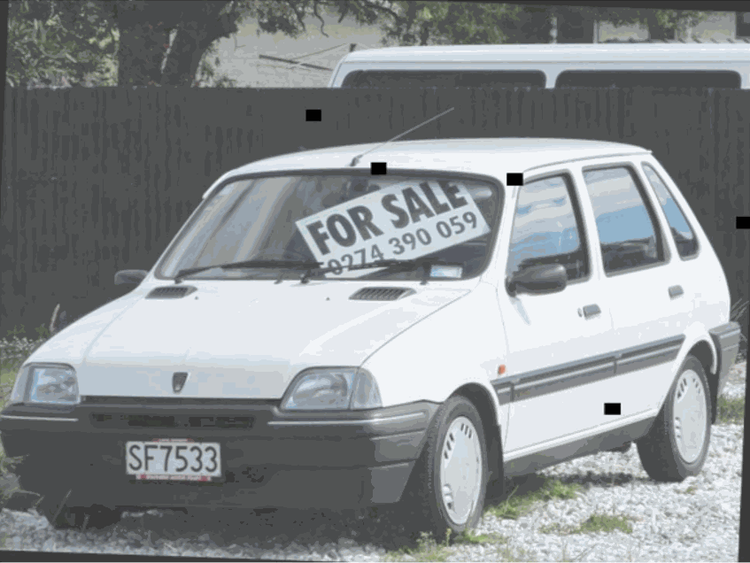
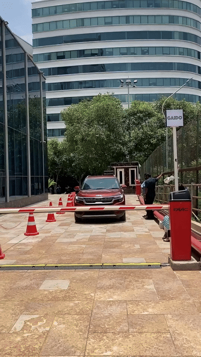
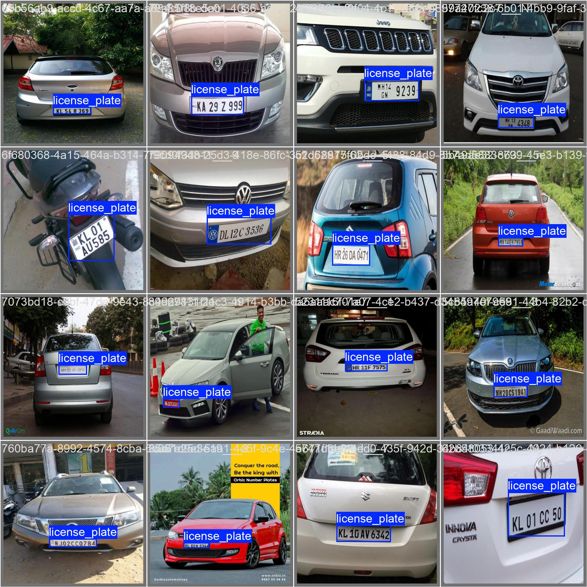
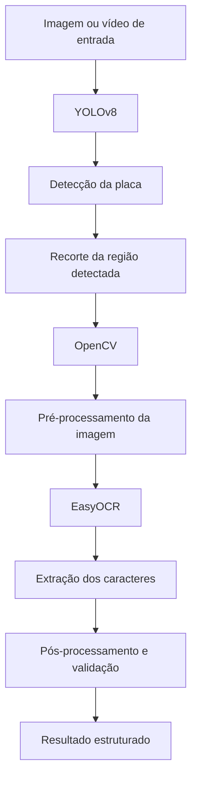

# ALPR — Reconhecimento Automático de Placas Veiculares

Projeto de **Automatic License Plate Recognition (ALPR)** utilizando **YOLOv8, OpenCV e EasyOCR** para detectar placas veiculares em imagens e vídeos e realizar a leitura dos caracteres identificados.

O projeto integra técnicas de visão computacional e reconhecimento óptico de caracteres (OCR) em um pipeline de processamento, desde a detecção da placa até a extração do texto.

## Demonstração

### 1. Detecção e reconhecimento em vídeo

<!-- Substitua pelo nome do primeiro GIF salvo na pasta results/ -->



### 2. Processamento em outro cenário

<!-- Substitua pelo nome do segundo GIF salvo na pasta results/ -->



### 3. Resultado da validação do modelo

A imagem abaixo apresenta exemplos de placas anotadas no conjunto de validação, permitindo visualizar as regiões utilizadas na avaliação do detector.

<!-- Confirme o nome do arquivo e copie-o para a pasta results/ -->



## Arquitetura da solução

O sistema foi organizado em etapas independentes, permitindo separar a localização da placa da leitura dos caracteres.



### Etapas do pipeline

**1. Entrada de dados**

O sistema recebe uma imagem ou um vídeo contendo veículos. No caso de vídeos, os quadros são processados individualmente.

**2. Detecção da placa — YOLOv8**

O modelo YOLOv8 treinado para a classe `license_plate` localiza as placas presentes na imagem e retorna as caixas delimitadoras (*bounding boxes*) e os respectivos níveis de confiança.

**3. Recorte da região de interesse**

As coordenadas da detecção são utilizadas para recortar a região da placa. Esse recorte reduz a área de imagem que será enviada para o OCR.

**4. Pré-processamento — OpenCV**

O OpenCV é utilizado no processamento das imagens, possibilitando preparar o recorte para a etapa de reconhecimento dos caracteres.

**5. Reconhecimento de caracteres — EasyOCR**

O EasyOCR recebe a imagem da placa e tenta identificar os caracteres presentes nela, retornando o texto reconhecido e informações de confiança.

**6. Pós-processamento e validação**

O texto reconhecido pode ser normalizado e validado conforme o padrão de placas esperado. Essa etapa também permite tratar ambiguidades entre caracteres visualmente semelhantes.

**7. Saída**

O resultado final pode reunir o texto reconhecido, a confiança da detecção e outras informações relevantes para cada placa processada.

## Tecnologias utilizadas

| Tecnologia | Aplicação |
|---|---|
| Python | Linguagem principal do projeto |
| YOLOv8 | Detecção de placas veiculares |
| OpenCV | Manipulação, recorte e pré-processamento de imagens |
| EasyOCR | Reconhecimento óptico de caracteres |
| Jupyter Notebook | Experimentação e desenvolvimento |
| Git e GitHub | Versionamento e publicação do projeto |

## Treinamento e avaliação

O detector foi treinado utilizando um conjunto de dados de placas veiculares com **1.648 imagens**. O treinamento teve como objetivo detectar placas como uma única classe: `license_plate`.

Os resultados do treinamento e da validação podem ser consultados nos gráficos e exemplos visuais disponibilizados na pasta `results/`.

<!-- Adicione os gráficos de treinamento aqui, se desejar -->

## Estrutura do projeto

```text
ALPR_YOLO_V8/
├── meus_modelos/
│   └── alpr_yolov8n/
│       └── weights/
│           └── best.pt
├── results/
│   ├── demo_alpr_1.gif
│   ├── demo_alpr_2.gif
│   ├── val_batch0_labels.jpg
│   └── ...
├── yolo.ipynb
├── .gitignore
└── README.md
```

## Como executar

**1. Clone o repositório**

```bash
git clone <URL_DO_REPOSITORIO>
cd ALPR_YOLO_V8
```

**2. Crie e ative um ambiente virtual**

```bash
python -m venv .venv
```

No Windows:

```powershell
.venv\Scripts\Activate.ps1
```

**3. Instale as dependências**

```bash
pip install ultralytics opencv-python easyocr jupyter
```

**4. Execute o notebook**

```bash
jupyter notebook yolo.ipynb
```

> Os comandos e as dependências deverão ser ajustados conforme a implementação final do notebook e do script de inferência.


## Autora

Projeto desenvolvido como parte dos estudos em Engenharia da Computação, com foco em **Machine Learning e Visão Computacional**.
